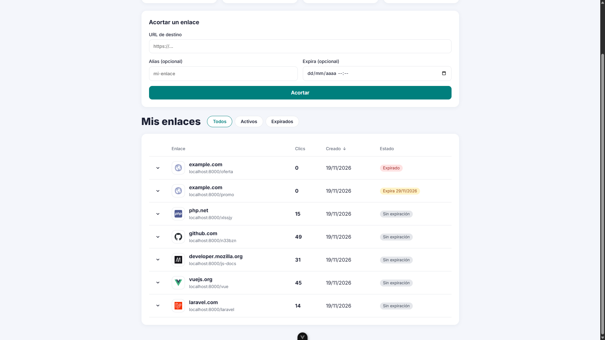
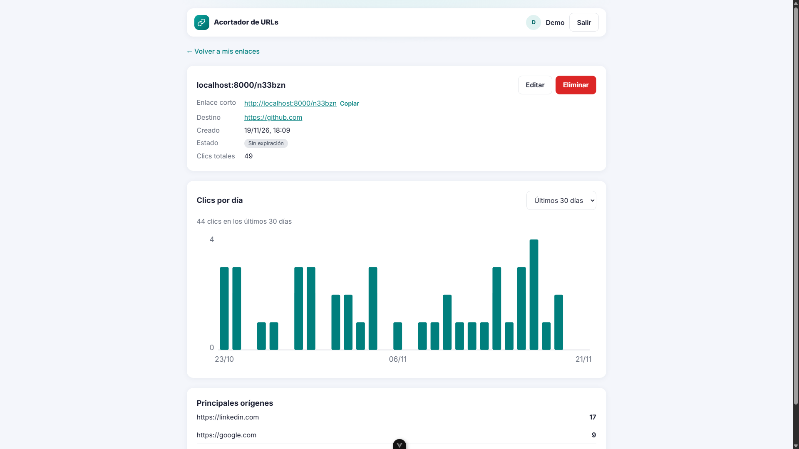

# Acortador de URLs

Acortador de enlaces con cuentas de usuario, redirección con registro de clics y estadísticas por día. Monorepo con una API en **Laravel 13** y una interfaz en **Vue 3**.

## Capturas




## Características

- Registro e inicio de sesión (tokens con Laravel Sanctum)
- Enlaces cortos con código aleatorio o alias personalizado
- Fecha de expiración opcional; edición del destino y de la expiración; reactivación de enlaces vencidos
- Redirección pública con conteo de clics y registro del origen y del navegador
- Estadísticas por enlace: clics por día (7, 30 o 90 días) y principales orígenes
- Cada usuario solo ve y modifica sus propios enlaces
- Tests automatizados del backend

## Tecnologías

- **Backend:** PHP 8.3+, Laravel 13, MySQL/MariaDB, Laravel Sanctum, PHPUnit
- **Frontend:** Vue 3 (Composition API), Vite, Vue Router, Pinia, gráfico en SVG propio (sin librerías de gráficos)

## Estructura

```
acortador-urls/
├── backend/    API REST en Laravel
├── frontend/   Interfaz en Vue
└── docs/       Capturas de pantalla
```

## Puesta en marcha

### Requisitos

- PHP 8.3+ y Composer
- MySQL o MariaDB
- Node.js 20.19+ o 22+

### Backend

```bash
cd backend
composer install
cp .env.example .env
php artisan key:generate
```

Crea una base de datos llamada `acortador_urls`, ajusta en `backend/.env` los datos de conexión (`DB_*`) y la URL del servidor (`APP_URL`), y ejecuta:

```bash
php artisan migrate --seed
php artisan serve
```

La API queda en `http://127.0.0.1:8000`. El parámetro `--seed` crea datos de demostración.

### Frontend

```bash
cd frontend
npm install
npm run dev
```

La interfaz queda en `http://localhost:5173`. El archivo `frontend/.env` define la URL de la API (`VITE_API_URL`); cámbiala si tu backend corre en otra dirección y reinicia `npm run dev`.

### Datos de demostración

Con `--seed` se crea un usuario de prueba con enlaces y clics de los últimos 30 días:

- Correo: `demo@example.com`
- Contraseña: `password`

## API

Las rutas protegidas requieren `Authorization: Bearer {token}` y el header `Accept: application/json`.

| Método | Ruta | Descripción | Auth |
|---|---|---|---|
| POST | `/api/register` | Crear cuenta | No |
| POST | `/api/login` | Iniciar sesión | No |
| POST | `/api/logout` | Cerrar sesión | Sí |
| GET | `/api/user` | Usuario autenticado | Sí |
| GET | `/api/links` | Listar enlaces (paginado) | Sí |
| POST | `/api/links` | Crear enlace (`original_url`, `alias`?, `expires_at`?) | Sí |
| GET | `/api/links/{id}` | Ver enlace | Sí |
| PUT | `/api/links/{id}` | Editar destino o expiración | Sí |
| DELETE | `/api/links/{id}` | Eliminar enlace | Sí |
| GET | `/api/links/{id}/stats?days=30` | Clics por día y principales orígenes | Sí |
| GET | `/{código}` | Redirección pública (302; 404 si no existe; 410 si expiró) | No |

## Decisiones técnicas

- **Códigos:** 6 caracteres en minúsculas y dígitos (unas 2.100 millones de combinaciones). Se evitan las mayúsculas porque MySQL compara texto sin distinguirlas y generaría duplicados. Los alias tienen formato validado y una lista de palabras reservadas.
- **Redirección 302:** un 301 lo cachea el navegador y las visitas siguientes no pasarían por el servidor, así que no se contarían ni se respetarían la expiración o el borrado.
- **Conteo de clics:** `total_clicks` se incrementa con una operación atómica en la base de datos, dentro de una transacción junto con el registro del clic.
- **Sin sesiones en la redirección:** la ruta pública queda fuera del grupo `web` para no crear una sesión ni una cookie por cada visita.
- **Enlaces expirados:** responden `410 Gone`, y se pueden reactivar asignándoles una fecha futura.
- **Validación de destinos:** solo `http` y `https`, y no se permite acortar enlaces del propio sitio (evita bucles).
- **Fechas:** el front envía la expiración en UTC; el backend la guarda en la zona horaria de la aplicación y la devuelve en UTC.
- **Estadísticas:** la agregación por día se hace en la base de datos y se rellenan con ceros los días sin clics, para devolver una serie completa lista para graficar.
- **Aislamiento:** todas las consultas parten del usuario autenticado, así que los enlaces de otros usuarios responden 404.

## Tests

```bash
cd backend
php artisan test
```

Los tests usan SQLite en memoria y cubren autenticación, reglas de negocio de los enlaces, redirección (incluido el conteo de clics, el 404 y el 410) y estadísticas.

## Autor

Saúl Fernando Ytusaca Quispe: https://www.linkedin.com/in/saul-fernando-ytusaca-quispe/